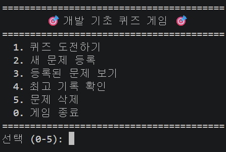
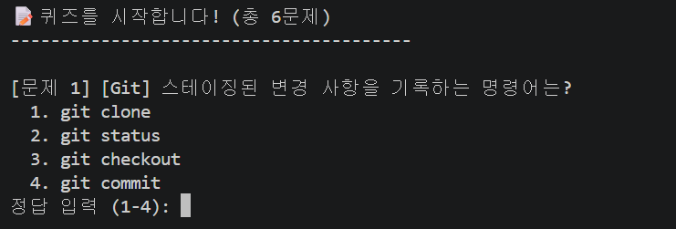
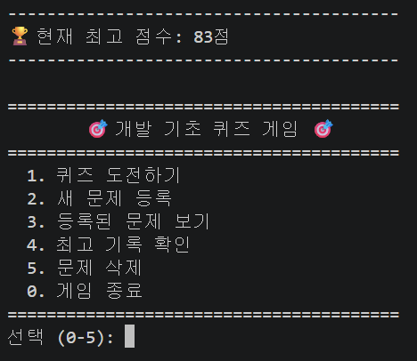
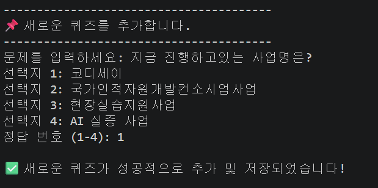
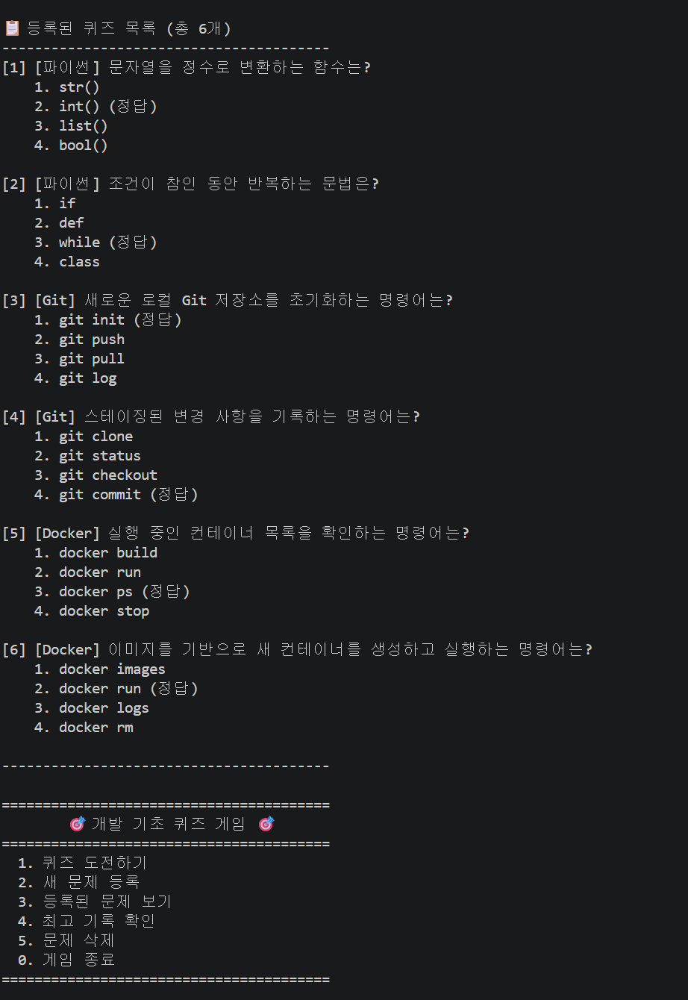
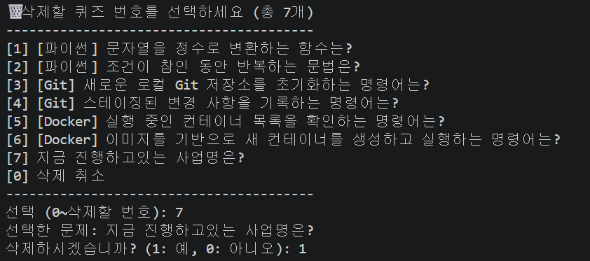

# 개발 기초 퀴즈 게임 (Python Quiz Game)

Python의 기본 문법과 클래스 활용을 익히고, JSON을 이용한 데이터 저장 및 Git을 통한 버전 관리를 실습하기 위해 만든 터미널 기반 퀴즈 프로그램입니다.

---

## 1. 프로젝트 개요
- **개발 언어**: Python 3.10+
- **사용 라이브러리**: Python 표준 라이브러리 (`json`, `os`, `sys`, `random`)
- **버전 관리**: Git, GitHub

---

## 2. 퀴즈 주제 및 선정 이유
- **퀴즈 주제**: Python, Git, Docker 기초 지식 (분야별 2문제, 총 6문제)
- **선정 이유**: 
  - 개발 입문 과정에서 배운 Python 문법과 Git, Docker의 주요 명령어를 복습하고, 퀴즈를 풀면서 학습한 내용을 스스로 점검하기 위해 선정했습니다.

---

## 3. 실행 방법

### 사전 요구사항
- Python 3.10 이상 설치 필요

### 실행 명령어
```bash
# 1. 저장소 클론
git clone https://github.com/YDG9976/1-2 quiz-project
cd quiz-project

# 2. 프로그램 실행
python quiz.py
```


### 메인 화면


### 문제 풀이 화면


### 최고 점수 확인


### 문제 추가 화면


### 퀴즈 목록 화면


### 커밋 및 브랜치 로그
<!--  -->

---

## 4. 주요 기능 목록

1. **퀴즈 풀기**
   - 등록된 문제를 무작위 순서로 출제하며, 1~4번 중 답을 입력하면 정답 여부를 알려줍니다. 오답인 경우 정답 번호와 내용을 함께 표시합니다.
   - 전체 문제 풀이가 끝나면 정답 수와 오답 수를 표시하고, 100점 만점으로 환산한 점수가 기존 최고 점수보다 높으면 기록을 갱신합니다.
2. **퀴즈 추가**
   - 문제 내용과 선택지 4개, 정답 번호를 입력하여 새 문제를 등록하고 JSON 파일에 저장합니다.
3. **퀴즈 목록 보기**
   - 등록된 문제와 선택지를 출력하며 정답에 별도로 표시합니다.
4. **최고 점수 확인**
   - 저장된 최고 점수를 조회합니다. 기록이 없거나 0점인 경우 안내 문구를 출력합니다.
5. **퀴즈 삭제 (보너스 기능)**
   - 삭제할 문제 번호를 선택하고 삭제 여부를 재확인한 뒤, 동의하면 해당 문제를 제거하고 변경 내용을 저장합니다.
6. **게임 종료**
   - 0번을 선택하면 현재 데이터를 저장하고 게임을 종료합니다.
7. **입력 및 오류 처리**
   - 입력값 앞뒤 공백 제거 (`strip()`)
   - 빈 입력, 숫자가 아닌 입력, 허용 범위를 벗어난 번호 입력 시 안내 후 재입력
   - 실행 중 `Ctrl + C` (`KeyboardInterrupt`) 또는 입력 종료(`EOFError`) 발생 시 저장을 시도한 뒤 프로그램 종료
   - `state.json`이 없거나 손상된 경우 기본 문제와 초기 점수로 복구하며, 파일 저장 오류 발생 시 안내 메시지 출력

---

## 5. 파일 구조

- `Quiz`: 문제, 선택지, 정답을 관리하고 문제 출력 및 채점을 담당합니다.
- `QuizGame`: 메뉴, 게임 진행, 문제 관리, 점수 및 파일 저장을 담당합니다.


```text
quiz-project/
│
├── quiz.py              # 퀴즈 게임 실행 및 클래스 정의
├── state.json           # 퀴즈 및 최고 점수 저장 데이터 (UTF-8)
├── README.md            # 프로젝트 안내 및 문서
└── .gitignore           # Git 제외 파일 목록
```

---

## 6. 데이터 파일 설명 (`state.json`)

- **경로**: 프로젝트 루트 디렉터리 (`./state.json`)
- **인코딩**: UTF-8
- **역할**: 등록된 문제와 최고 점수를 저장하여 다음 실행 시 불러오는 역할
- **JSON 스키마 구조** (문제 1개와 초기 점수를 예로 표시):
```json
{
    "quizzes": [
        {
            "question": "[파이썬] 문자열을 정수로 변환하는 함수는?",
            "choices": [
                "str()",
                "int()",
                "list()",
                "bool()"
            ],
            "answer": 2
        }
    ],
    "best_score": 0
}
```

---

## 7. 보너스 미션
- **랜덤 출제**: `random.shuffle()`을 사용해 복사한 문제 목록을 섞어 출제합니다.
- **문제 삭제**: 삭제할 문제를 선택하고 확인 절차를 거쳐 삭제하며, 결과를 파일에 반영합니다.

